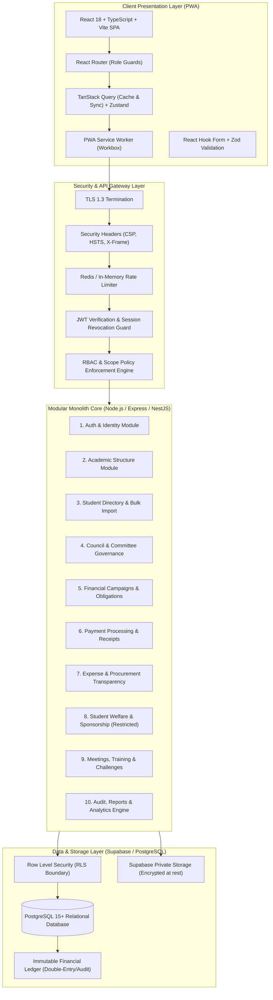

# KEYDSO MAANTA — System Architecture Proposal
**Document Version:** 1.0.0  
**Status:** Under Council Review (Phase 0 Deliverable)  
**Engineering Team:** Principal Software Architect, Senior React/TS Dev, Senior Node.js Dev, PostgreSQL Architect, AppSec Engineer, DevOps & Cloud Engineer

---

## 1. Executive Summary & Architectural Vision

**Keydso Maanta** is an enterprise-grade, privacy-respecting, auditable university Student Representative Council (SRC) management system. Built as a Progressive Web Application (PWA) backed by a robust Node.js/TypeScript REST API and Supabase PostgreSQL, it delivers high availability, strict role-based and scope-based access control (RBAC/ABAC), and immutable financial accounting.

The platform answers five fundamental institutional questions:
1. **Who represents each student?** (Faculty/department representative registry with verified credentials and contact pathways).
2. **How much money has been collected from students?** (Real-time verified collections, campaign obligations, and reconciliation against bank/mobile accounts).
3. **What was the collected money used for?** (Complete expenditure tracing from request to approval, disbursement, evidence upload, and verified receipt publication).
4. **What activities are the council and its committees performing?** (Meeting minutes, training sessions, task logs, and challenge resolution workflows).
5. **What results have the representatives delivered?** (Outcome metrics, verified resolutions, and historical semester comparative audits).

---

## 2. High-Level Architectural Pattern: Clean Modular Monolith

We adopt a **Clean Modular Monolith** architecture. While microservices introduce distributed transaction overhead, network latency, and operational fragility, a modular monolith guarantees strong transactional consistency (ACID) essential for financial contributions and student records, while maintaining strict logical domain boundaries.



---

## 3. Technology Stack Rationale

| Layer | Selected Technology | Justification |
|---|---|---|
| **Frontend Framework** | React 18 + TypeScript + Vite | Type safety across API contracts, rapid HMR build times, lightweight bundle footprint. |
| **Styling & UI** | Tailwind CSS + Lucide React | Utility-first responsive design, mobile-first layouts, zero runtime CSS penalty. |
| **State & Data Fetching**| TanStack Query v5 + Zustand | Automatic cache invalidation, optimistic UI updates, resilient network retry strategies. |
| **Form Validation** | React Hook Form + Zod | Schema-first client validation matching backend DTO schemas identically. |
| **PWA Engine** | Vite PWA Plugin + Workbox | Offline shell, manifest installation, asset caching with strict exclusion of sensitive financial data. |
| **Backend Runtime** | Node.js (v22+) + TypeScript | High throughput asynchronous I/O, shared TypeScript interfaces with frontend. |
| **API Architecture** | Express.js / NestJS Modular Architecture | Clear dependency injection, controller-service-repository layered structure, explicit guards. |
| **Database Engine** | PostgreSQL 15+ (Supabase) | Strict ACID compliance, relational integrity, partial indexing, transactional locks (`SELECT FOR UPDATE`), Row Level Security. |
| **File Storage** | Supabase Storage (Private Buckets) | Granular access control, signed short-lived URLs (15-min TTL), antivirus and MIME validation. |
| **Testing** | Vitest, Supertest, Playwright | Comprehensive unit, integration, and E2E coverage across student and financial personas. |

---

## 4. Frontend Architecture & Modular Boundaries

The client application is organized by domain features to prevent monolithic coupling:

```
apps/web/src/
├── app/                  # Application root, providers, router configuration
├── components/           # Reusable atomic UI (Button, Modal, Table, Badge, Input, Card)
├── features/             # Feature slices:
│   ├── auth/             # Login, recovery, MFA, session management
│   ├── academic/         # Years, semesters, faculties, departments, cohorts
│   ├── students/         # Directory, student profile, bulk import preview
│   ├── council/          # President, committee boards, task management
│   ├── finance/          # Campaigns, obligations, payment entries, verification
│   ├── expenses/         # Expense requests, approvals, procurement evidence
│   ├── welfare/          # Confidential hardship requests, sponsorship tracking
│   ├── meetings/         # Meeting requests, attendance, minutes
│   ├── challenges/       # Student/faculty challenges, escalations
│   └── reports/          # Financial summaries, semester analytics, exports
├── hooks/                # Global custom hooks (useAuth, usePWA, useDebounce)
├── services/             # Axios/fetch API clients with auth interceptors
├── routes/               # Role-protected route guards (AdminRoute, FinanceRoute, etc.)
└── types/                # TypeScript shared contract definitions
```

### Frontend State and Cache Management
1. **Server State (TanStack Query):**
   - Query keys partitioned by entity and scope: `['obligations', studentId]`, `['expenses', campaignId]`.
   - Stale time configured per entity volatility (e.g., 30 seconds for pending payments; 5 minutes for academic structures).
   - Invalidation triggers automatically upon mutation completion.
2. **Client State (Zustand):**
   - Active user session, active academic year/semester filter, PWA offline status, notification counter.
   - Zero storage of authentication tokens in plain `localStorage` when httpOnly cookies are active.

---

## 5. Backend Architecture & Request Lifecycle

The backend enforces a strict four-layer architecture:

```
┌────────────────────────────────────────────────────────┐
│ 1. Controller Layer: REST Endpoints, DTO Validation    │
└───────────────────────────┬────────────────────────────┘
                            │
┌───────────────────────────▼────────────────────────────┐
│ 2. Security & Guard Layer: RBAC, ABAC, Scope Guards    │
└───────────────────────────┬────────────────────────────┘
                            │
┌───────────────────────────▼────────────────────────────┐
│ 3. Service / Domain Layer: Business Logic, State Machine│
└───────────────────────────┬────────────────────────────┘
                            │
┌───────────────────────────▼────────────────────────────┐
│ 4. Data / Repository Layer: Transactions, Audit & SQL   │
└────────────────────────────────────────────────────────┘
```

### Request Lifecycle Example (Payment Verification):
1. **Request Received:** `POST /api/v1/finance/payments/:id/verify`
2. **Security Interceptor:** Validates JWT signature, checks user account status (not suspended), ensures user has `finance:verify_payment` permission.
3. **Scope Enforcement:** Verifies that the verifier is NOT the officer who originally recorded the payment (Four-Eyes Principle / Separation of Duties).
4. **Database Transaction (`BEGIN`):**
   - Locks payment record: `SELECT * FROM payments WHERE id = $1 FOR UPDATE`.
   - Validates transition state: Status must be `PENDING`.
   - Updates payment status to `VERIFIED` and sets `verified_by`, `verified_at`.
   - Creates immutable ledger entry: Credits designated fund account.
   - Updates obligation paid amount and recalculates status (`PARTIALLY_PAID` or `PAID`).
   - Generates sequential cryptographically verified receipt number.
   - Records structured audit log entry in `audit_logs`.
5. **Transaction Commit (`COMMIT`):** All ledger entries, receipt records, and obligation adjustments persist atomically.
6. **Background Event Dispatch:** Fires in-app notification to student: *"Your payment of $XX for Campaign YY has been verified. Receipt #ZZ is available."*

---

## 6. Progressive Web Application (PWA) & Offline Strategy

To meet the requirement of mobile responsiveness and variable connectivity across campus environments:

### Service Worker Caching Policies (Workbox):
- **App Shell & Static Assets (Cache-First):** JS bundles, CSS, fonts, SVG icons, logo assets. Serviced instantly offline with background updates.
- **Academic Hierarchy & Rep Directory (Stale-While-Revalidate):** Faculties, departments, student representatives directory. Cached for instant viewing with revalidation in background.
- **Financial & Student Private Data (Network-Only / STRICT NO-CACHE):**
  - Endpoints `/api/v1/finance/*`, `/api/v1/students/me/*`, `/api/v1/welfare/*` are explicitly bypassed by the Service Worker cache.
  - Reason: Shared device security (campus cyber cafés, library terminals) prevents financial data lingering in CacheStorage.
- **Offline Action Queue (IndexedDB):**
  - When offline, non-destructive actions (e.g., drafting a meeting minute or submitting a student challenge) are queued in local IndexedDB.
  - When connection is restored, the queue replays operations with idempotency keys.
  - Financial payments are NEVER marked as complete offline; students receive clear feedback: *"Offline: Transaction submission will be transmitted once connectivity is restored."*

---

## 7. Scalability & Performance Strategy

1. **Connection Pooling:** PgBouncer integrated at database layer to handle concurrent student traffic during contribution deadlines.
2. **Read vs Write Optimization:** Heavy analytics (e.g., aggregate collection percentage by faculty) are cached using materialized views or Redis, refreshed upon financial batch commits.
3. **Database Indexing:** Compound indexes on `(campaign_id, status)`, `(student_id, academic_year_id)`, and `(faculty_id, department_id)`.
4. **Asset Optimization:** Vite tree-shaking, dynamic imports (`React.lazy`) for admin and finance dashboards to keep the student bundle sub-150KB gzipped.
