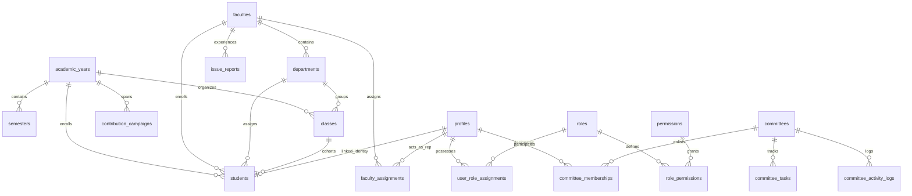
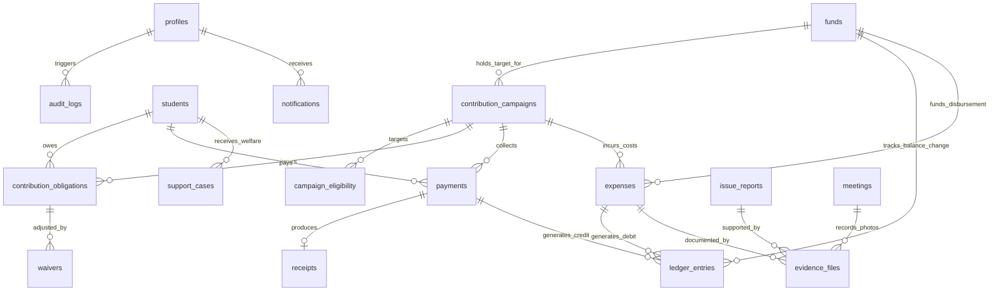

# KEYDSO MAANTA — Entity Relationship Diagram (ERD)
**Document Version:** 1.0.0  
**Status:** Approved for Schema Generation

---

## 1. Core Academic & Identity Architecture

---

## 2. Financial Ecosystem & Audit Trail

---

## 3. Relational Cardinality & Integrity Matrix

| Parent Table | Child Table | Foreign Key | Constraint Rule | Business Meaning |
|---|---|---|---|---|
| `academic_years` | `semesters` | `academic_year_id` | `ON DELETE RESTRICT` | A year cannot be purged if it has active semesters. |
| `faculties` | `departments` | `faculty_id` | `ON DELETE RESTRICT` | Departments cannot be orphaned without a faculty. |
| `departments` | `students` | `department_id` | `ON DELETE RESTRICT` | Students must belong to a verified valid department. |
| `contribution_campaigns` | `contribution_obligations` | `campaign_id` | `ON DELETE RESTRICT` | Campaigns with active student obligations cannot be deleted. |
| `contribution_obligations` | `waivers` | `obligation_id` | `ON DELETE RESTRICT` | Waivers must reference an active student liability. |
| `payments` | `receipts` | `payment_id` | `ON DELETE RESTRICT` | A verified receipt cannot exist without its originating payment. |
| `funds` | `ledger_entries` | `fund_id` | `ON DELETE RESTRICT` | Ledger records are permanent; fund references cannot be severed. |
| `expenses` | `evidence_files` | `entity_id` | `ON DELETE RESTRICT` | Approved expenses must maintain linked invoices and evidence. |
