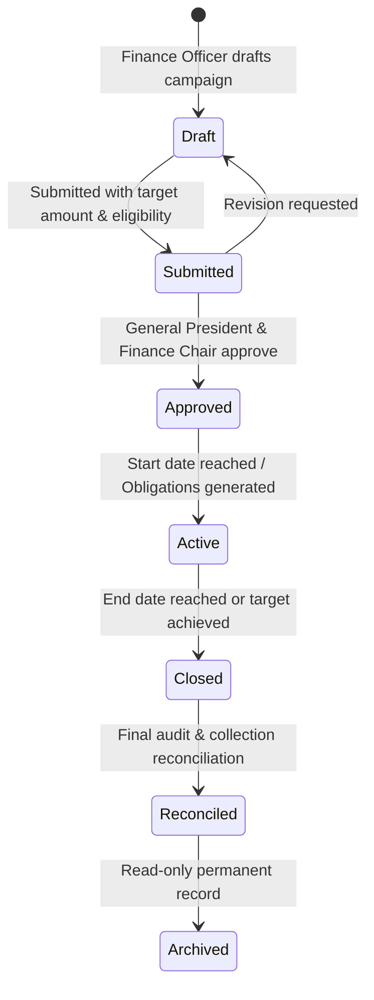
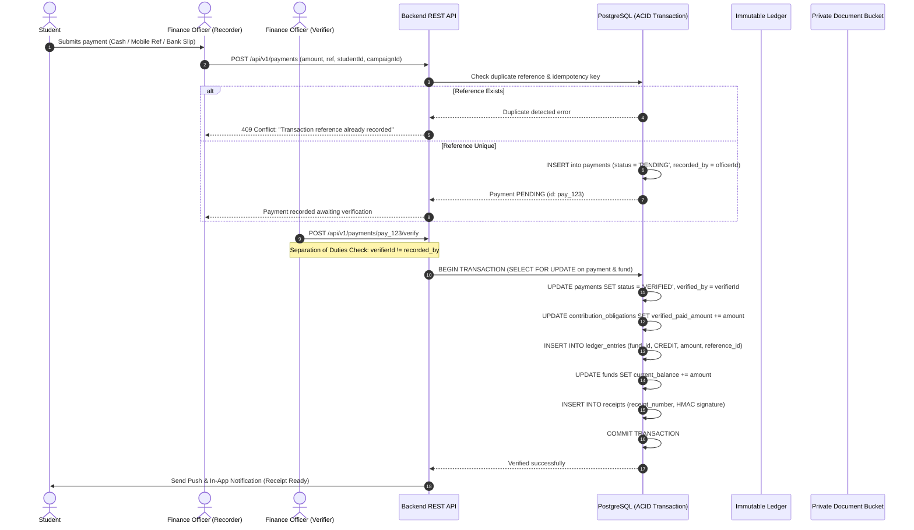
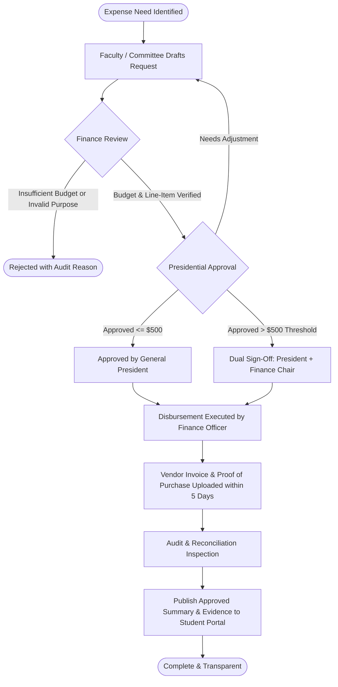

# KEYDSO MAANTA — Financial Architecture & Workflow Specifications
**Document Version:** 1.0.0  
**Enforcement:** Atomic Database Transactions (`BEGIN ... COMMIT`), Separation of Duties, Immutable Double-Entry Ledger, Idempotency Guard.

---

## 1. Core Financial Principles

1. **No Silent Deletions:** Financial records are immutable. Mistakes are corrected exclusively via documented reversals and adjusting ledger entries.
2. **Separation of Duties (Four-Eyes Principle):**
   - The officer who creates an expense request CANNOT approve it.
   - The officer who records a payment CANNOT verify it.
   - The officer who disburses funds CANNOT single-handedly audit reconciliation.
3. **Strict Backend Authority:** All balances, remaining amounts, and eligibility checks are calculated in PostgreSQL/Node.js. Frontend values are treated purely as display projections.
4. **Race Condition Prevention:** Payment verification and fund disbursements use row-level pessimistic locks (`SELECT ... FOR UPDATE`).
5. **Idempotency Guarantee:** Every incoming financial mutation requires a unique `idempotency_key` (UUID v4) stored in the database to prevent duplicate transactions on network retries.

---

## 2. Campaign Lifecycle State Machine



### Lifecycle Rules:
- **No Collections Before Active:** Payments cannot be recorded against a campaign with status `DRAFT`, `SUBMITTED`, or `ARCHIVED`.
- **Obligation Generation:** When a campaign transitions to `ACTIVE`, the system runs a batch procedure generating `contribution_obligations` for all students matching the `campaign_eligibility` rules.

---

## 3. Contribution & Payment Processing Workflow



---

## 4. Expenditure & Procurement Workflow

Every dollar spent from student funds follows a multi-tier approval pipeline:



### Key Expenditure Safeguards:
1. **Budget Availability Check:** The backend rejects any expense request if `requested_amount > fund.current_balance`.
2. **Two-Person Approval Above Threshold:** Configurable institution threshold (e.g., $500). Transactions exceeding this limit trigger automated dual signature requirement.
3. **Mandatory Evidence Linking:** An expense cannot be marked `RECONCILED` without at least one verified vendor invoice/receipt uploaded to `evidence_files`.
4. **Student Transparency View:** Once marked `RECONCILED` and `is_public_summary_published = TRUE`, students see:
   - Campaign: Faculty Student Support
   - Purpose: Lab Equipment Maintenance
   - Amount: $450.00
   - Vendor: TechSupplies Ltd
   - Approver: General President & Finance Chair
   - Proof: Verified Invoice PDF & Item Photo

---

## 5. Mathematical Integrity & Balance Equations

The application enforces strict financial balance conservation across all transactions:

$$\text{Expected Campaign Collection} = \sum_{i=1}^{n} \text{obligation}_i.\text{expected\_amount}$$

$$\text{Student Remaining Balance} = \text{expected\_amount} - (\text{verified\_paid} + \text{waived\_amount} + \text{sponsored\_amount})$$

$$\text{Total Verified Collections} = \sum \text{payments (status = 'VERIFIED')} - \sum \text{payments (status = 'REVERSED')}$$

$$\text{Fund Available Balance} = \text{Opening Balance} + \sum \text{CREDIT Ledger Entries} - \sum \text{DEBIT Ledger Entries}$$

### Integrity Trigger Specification (PostgreSQL):
```sql
-- Trigger prevents negative fund balance
CREATE OR REPLACE FUNCTION check_fund_solvency()
RETURNS TRIGGER AS $$
BEGIN
    IF NEW.current_balance < 0.00 THEN
        RAISE EXCEPTION 'Financial Invariant Violation: Fund % cannot have a negative balance (attempted balance: %)', 
            NEW.id, NEW.current_balance;
    END IF;
    RETURN NEW;
END;
$$ LANGUAGE plpgsql;
```
