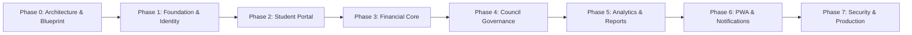

# KEYDSO MAANTA — Engineering Implementation Roadmap & Risk Gates
**Document Version:** 1.0.0  
**Methodology:** Incremental Agile-Engineering with Formal Security & Quality Gates

---

## Roadmap Overview & Phase Delivery Milestones

---

### Phase 0: Project Inspection & Architecture (Current)
- [x] Repository environment inspection (Node.js v22+, npm 10+, Git).
- [x] Monorepo folder scaffolding and architecture proposal (`docs/ARCHITECTURE.md`).
- [x] Normalized PostgreSQL schema specification and data dictionary (`docs/DATABASE.md`).
- [x] Entity Relationship Diagram in Mermaid (`docs/ERD.md`).
- [x] Complete Role & Permission Matrix (`docs/ROLE_PERMISSION_MATRIX.md`).
- [x] Financial workflow, equations & state machines (`docs/FINANCIAL_WORKFLOW.md`).
- [x] Application Security Threat Model (STRIDE) (`docs/SECURITY_THREAT_MODEL.md`).
- [x] Environment variable specifications (`docs/ENV_SPECIFICATION.md`).
- [x] Assumptions requiring student council review (`docs/COUNCIL_ASSUMPTIONS.md`).
- **Phase Gate 0:** Formal blueprint review and sign-off before Phase 1 code implementation.

---

### Phase 1: Foundation, Academic Structure & Identity
- **Goals:** Monorepo package setup, PostgreSQL connection, database migration engine, authentication system, RBAC middleware, academic hierarchy management, and student bulk import.
- **Tasks:**
  1. Monorepo structure (`apps/web`, `apps/api`, `packages/shared-types`).
  2. Database migration `001_initial_schema.sql` (PostgreSQL / Supabase RLS).
  3. Authentication module: JWT / Session login, Argon2id hashing, rate-limiting guard.
  4. User profiles & RBAC assignment API with audit logging.
  5. Academic hierarchy endpoints: `academic_years`, `semesters`, `faculties`, `departments`, `classes`.
  6. Bulk student import service: CSV/XLSX parsing, format validation, duplicate detection, dry-run preview, atomic insertion.
  7. Admin UI: Academic hierarchy tree view, user management, and bulk import wizard.
- **Verification Gate:** Passing unit & integration tests for password hashing, token validation, RBAC guards, and bulk import error handling.

---

### Phase 2: Student Portal Experience
- **Goals:** Deliver the self-service student interface with mobile responsiveness and privacy compliance.
- **Tasks:**
  1. Student authentication and profile onboarding.
  2. Student Dashboard: Active academic semester, personal enrolled faculty & department.
  3. Representative Directory: Verified faculty & department reps with photos, biographies, and designated contact buttons (Phone, Email, WhatsApp).
  4. Personal Contribution Summary: Applicable campaigns, expected amounts, verified paid, outstanding balances, and official receipt downloads.
  5. Transparency Feed: Publicly released council spending summaries and evidence photos.
  6. Feedback & Challenge Submission: Mechanism for students to submit concerns to their faculty rep.
- **Verification Gate:** Verification that students cannot access other students' records (IDOR tests passing).

---

### Phase 3: Auditable Financial System
- **Goals:** Implement campaigns, obligations, payments, receipts, immutable ledger, and expenditure workflows.
- **Tasks:**
  1. Contribution Campaign Management: Creation, eligibility rules, lifecycle transitions (`DRAFT` -> `ACTIVE`).
  2. Obligation Engine: Automatic calculation of student liabilities upon campaign activation.
  3. Payment Recording Service: Cash, Mobile Money, and Bank Transfer entries with idempotency keys and duplicate detection.
  4. Payment Verification Workflow: Four-eyes check (`recorded_by != verified_by`), atomic ledger creation, and cryptographic receipt generation.
  5. Expense & Procurement Module: Expense requests, multi-tier presidential/finance approval, disbursement logging, and evidence file uploads.
  6. Student Welfare & Sponsorship Module: Restricted hardship cases with confidential reviewer notes.
- **Verification Gate:** Financial test suite passing (duplicate transaction prevention, balance equation invariant checks, negative balance rejection).

---

### Phase 4: Council & Committee Governance
- **Goals:** Equip General President, Faculty Presidents, and Council Committees with operational workspaces.
- **Tasks:**
  1. General President Dashboard: Institution-wide health indicators, cross-faculty monitoring, proposal approval queue.
  2. Faculty President Workspace: Faculty-scoped student directory, reps, meetings, and challenge tracker.
  3. Committee Management System: Task assignment boards, daily activity logs, weekly/monthly report generator.
  4. Meeting & Training Module: Meeting requests, presidential review, agenda, attendance tracking, and minute archival.
  5. Faculty Challenges Workflow: Status lifecycle (`SUBMITTED` -> `IN_PROGRESS` -> `RESOLVED`), priority assignment, and resolution notes.
- **Verification Gate:** Cross-faculty permission boundary tests (ensuring Faculty President A cannot modify Faculty B).

---

### Phase 5: Reports, Analytics & Exports
- **Goals:** Provide data-driven transparency tools for leadership, council meetings, and student assemblies.
- **Tasks:**
  1. Analytics Engine: Dynamic SQL aggregations for collection progress, expense breakdowns, and faculty resolution metrics.
  2. Interactive Visualizations: Chart.js / Recharts for expected vs collected, faculty performance, and fund balance trends.
  3. Historical Semester Comparisons: Trend comparison between active and prior academic years.
  4. Export Pipeline: High-fidelity PDF reports with official council watermarks, alongside verified Excel and CSV exports.
- **Verification Gate:** Exported reports verified against raw database balances to ensure 100% data fidelity.

---

### Phase 6: PWA & Notification Engine
- **Goals:** Deliver progressive web app capabilities, mobile installability, and real-time alerts.
- **Tasks:**
  1. Web App Manifest and PWA Service Worker (Vite PWA / Workbox).
  2. Offline-safe caching for static shells and public directory; strict cache exclusion for private financial endpoints.
  3. In-App Notification Center: Unread counter, event triggers (payment verified, meeting approved, announcement).
  4. Web Push Notification integration (VAPID protocol).
  5. Mobile-first UI audit: Verification across 360px to 1920px screen viewports.
- **Verification Gate:** Lighthouse PWA audit score >= 90; offline resilience verification.

---

### Phase 7: Security Hardening & Production Preparation
- **Goals:** Execute end-to-end security audits, disaster recovery drills, and deployment packaging.
- **Tasks:**
  1. OWASP ASVS verification and automated security test suite (SQLi, XSS, CSRF, IDOR).
  2. Database backup & restore script validation.
  3. GitHub Actions CI/CD pipeline (linting, type checking, test execution, container/production build).
  4. Production environment configuration review & secret isolation audit.
  5. Operational User Manuals (Admin, President, Finance, Faculty Rep, Student).
- **Verification Gate:** Zero unresolved high/critical security findings; 100% passing test suite.
